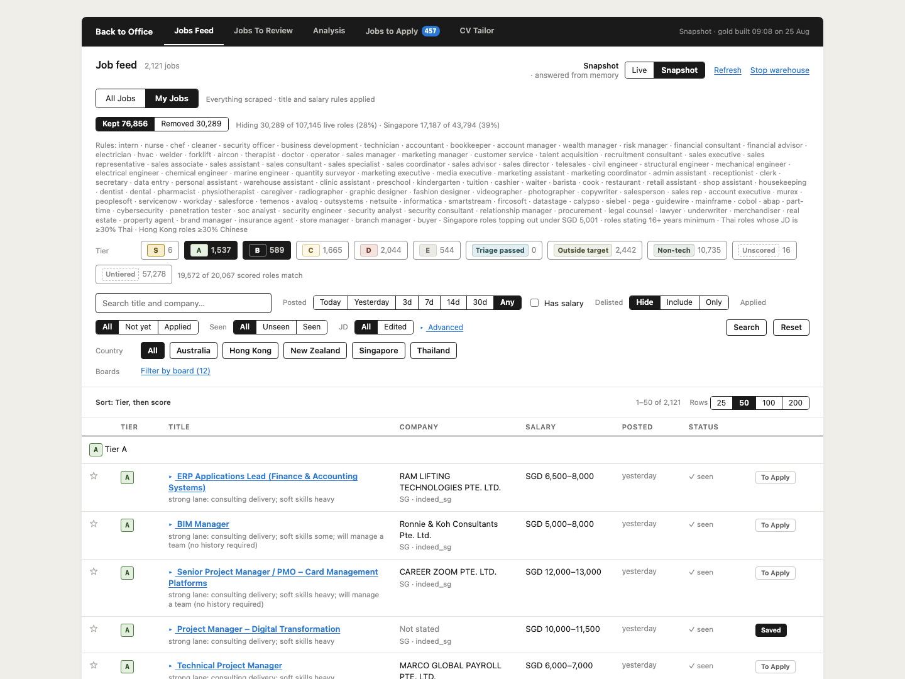

# Back to Office

**A job search pipeline built to make finding a job less of a full-time job.**

Back to Office runs B's searches across multiple job boards every day,
collects new and updated listings, deduplicates the same jobs appearing across
different sources, and filters and buckets what remains.

Instead of reading thousands of JDs, B reviews around 300 in a web interface,
with the system surfacing the key reasons for and against each job. B makes the
final decision on what is worth applying for.

For selected jobs, Back to Office then tailors a CV against B's evidence bank,
researches the original job opening and relevant hiring contacts, and helps with
the application and outreach process.

Finally, it tracks what happens after applying — from recruiter interest and CV
link clicks to recruiter calls, interviews, offers and rejections.

The aim isn't to automate the decision of where B should work. It's to automate
as much of the work around that decision as possible.

<p align="center">
  <picture>
    <source srcset="demo.webp" type="image/webp">
    
  </picture>
</p>

<p align="center">
  <a href="https://www.python.org/"></a>
  <a href="https://www.postgresql.org/"></a>
  <a href="https://www.databricks.com/"></a>
  <a href="https://spark.apache.org/"></a>
  <a href="https://delta.io/"></a>
  <a href="https://aws.amazon.com/lightsail/"></a>
  <a href="LICENSE"></a>
</p>

## How it works

```
┌─ 1 ─ find new job listings ────────────────────────────────────────────────────────────────┐
│   ├─ run B's searches across job boards such as LinkedIn, Indeed, JobStreet and            │
│   │  MyCareersFuture, across various markets e.g. Singapore, Hong Kong, Thailand           │
│   ├─ MyCareersFuture and JobStreet return summary cards, so download the job               │
│   │  description only when the card is new or its change signal moved. Indeed and          │
│   │  LinkedIn return the description with the search result, so there is nothing           │
│   │  to re-request                                                                         │
│   ├─ save each payload as raw JSON in a Databricks Bronze volume                           │
│   ├─ write one Bronze observation per job seen — board job id, change signal and           │
│   │  content hash — the state the next run compares against                                │
│   └─ record each Apify run's reported cost in PostgreSQL; a cost write that fails          │
│      is logged and reported, never a reason to fail the scrape                             │
└──────────────────────────────────────────────┬─────────────────────────────────────────────┘
                                               │  ~4,500 new or edited job listings saved each day
                                               ▼
┌─ 2 ─ standardize and canonicalize job listings ────────────────────────────────────────────┐
│   ├─ standardize listings from every job board into one common schema                      │
│   ├─ preserve the richest available job description and derive clean text for matching     │
│   ├─ build matching features such as MinHash and compare likely duplicates across boards   │
│   └─ group listings that represent the same job under one canonical job                    │
└──────────────────────────────────────────────┬─────────────────────────────────────────────┘
                                               │  ~3,000 job listings to filter and bucket
                                               ▼
┌─ 3 ─ filter and bucket job listings ───────────────────────────────────────────────────────┐
│   ├─ pull the cleaned job listings needed for processing into PostgreSQL                   │
│   ├─ rule-based title and language filters remove clearly irrelevant or ineligible         │
│   │  listings before using the LLM                                                         │
│   ├─ LLM-based triage filters out non-technical roles and other technical work outside     │
│   │  the configured job preferences                                                        │
│   ├─ structured extraction pulls the facts needed from listings                            │
│   ├─ rule-based evaluation compares those facts with the configured preferences            │
│   │  and places each job listing into its review bucket                                    │
│   └─ suppress recent repeats with the same results and send the morning summary            │
└──────────────────────────────────────────────┬─────────────────────────────────────────────┘
                                               │  ~300 new JDs to review each day
                                               ▼
┌─ 4 ─ manually review JDs ──────────────────────────────────────────────────────────────────┐
│  PostgreSQL                                                                                │
│  B reviews each JD that made it past triage and filtering in a web interface               │
│   ├─ spend ~12 seconds per JD, ~1 hour for the ~300 JDs that arrive each day               │
│   └─ back-to-office system surfaces the key points for and against each job, including     │
│      the reasoning behind its assigned bucket                                              │
└──────────────────────────────────────────────┬─────────────────────────────────────────────┘
                                               │  ~100 jobs saved to apply
                    ┌──────────────────────────┴───────────┬───────────────────────────────────┐
                    ▼                                      ▼                                   ▼
┌─ 5a ─ tailor custom CV ──────────────┐  ┌─ 5b ─ find the direct listing ─┐  ┌─ 5c ─ enrich the job listing ──┐
│   ├─ read the JD and work out the    │  │   ├─ find the original listing │  │   ├─ identify recruiters,      │
│   │  angle: what is really being     │  │   │  for the selected job      │  │   │  likely hiring managers    │
│   │  hired for, and where B fits     │  │   ├─ prefer the employer's     │  │   │  and relevant team members │
│   ├─ match that to B's evidence bank │  │   │  careers site or its       │  │   ├─ find useful contact,      │
│   │  — real projects, numbers, dates │  │   │  authorised application    │  │   │  profile and company       │
│   ├─ anti-hallucination pass: every  │  │   │  portal                    │  │   │  information               │
│   │  claim must trace to a line in   │  │   └─ identify where to apply,  │  │   └─ keep the findings with    │
│   │  the bank, or it is cut and the  │  │      or say when no direct     │  │      their sources and why     │
│   │  draft loops until clean         │  │      listing can be found      │  │      each person is relevant   │
│   └─ render an ATS-readable PDF      │  │                                │  │                                │
└──────────────────────────────────────┘  └────────────────────────────────┘  └────────────────────────────────┘
                    └──────────────────────────┬───────────┴───────────────────────────────────┘
                                               ▼
┌─ 6 ─ apply for selected jobs ──────────────────────────────────────────────────────────────┐
│   ├─ B submits job applications manually initially                                         │
│   ├─ later, OpenClaw takes over repetitive form filling, leaving applications              │
│   │  open for B to review before submission                                                │
│   └─ use the job and contact data gathered earlier to send targeted outreach               │
│      to relevant hiring managers or recruiters for selected applications                   │
└──────────────────────────────────────────────┬─────────────────────────────────────────────┘
                                               │                          incoming recruiter call
                           ┌───────────────────┘                                     │
                           │                                                         ▼
                           │                                                    ElevenLabs
                           │                                                         │
                           ▼                                                         ▼
┌─ 7a ─ track job applications ──────────────────────┐    ┌─ 7b ─ report recruiter calls ──────────────────────┐
│   ├─ keep each application, its CV and links       │    │   ├─ receive completed recruiter calls from        │
│   │  together                                      │    │   │  ElevenLabs                                    │
│   ├─ record activity on CV links as possible signs │    │   └─ email B the call details, transcript and      │
│   │  of interest                                   │    │      recording when available                      │
│   └─ track progress, notes and next steps after    │    │                                                    │
│      applying                                      │    │                                                    │
└────────────────────────────────────────────────────┘    └────────────────────────────────────────────────────┘
```

## Structure

```text
back-to-office/
├── AGENTS.md
├── Makefile
├── pyproject.toml
├── deploy/
└── src/bto/
    ├── settings.py            # env, secrets, which boards are switched on
    │
    ├── fetch_job_listings/    # 1 — find and ingest new job listings
    │                          #     http_client.py and apify_client.py live in here
    ├── clean_job_listings/    # 2 — standardize and canonicalize job listings
    ├── filter_and_bucket_job_listings/ # filter jobs into review buckets
    ├── review_jds/            # 4 — review JDs and decide which jobs to apply for
    ├── tailor_cvs/            # 5a — tailor custom CVs for each job application
    ├── research_job_listing/  # 5b — find the direct listing
    ├── apply_for_jobs/        # 6 — applications and targeted outreach
    ├── track_applied_jobs/    # 7a — track application interest and progress
    │
    ├── web/                   # web interface and API
    ├── analytics/             # data analyses
    ├── record_costs/          # track operating and API costs
    ├── send_notifications/    # send system alerts and summaries
    │
    ├── storage/
    │   ├── databricks/        # medallion layers and raw volumes
    │   ├── postgres/          # operational database (OLTP)
    │   └── s3/                # read and write data from S3 bucket
    │
    └── sync/                  # move data between Databricks and PostgreSQL
```

## License

[MIT](LICENSE) © 2026 Belinda H. J. Wan
